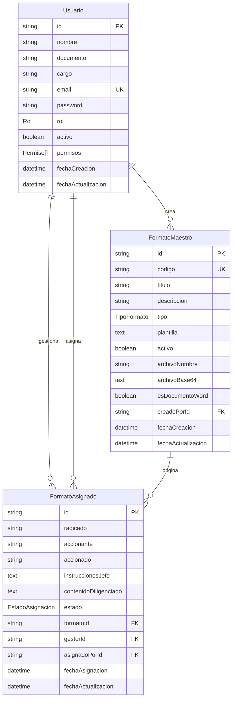
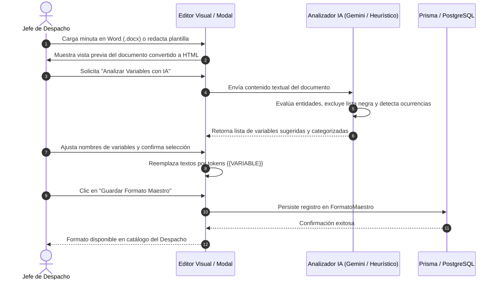
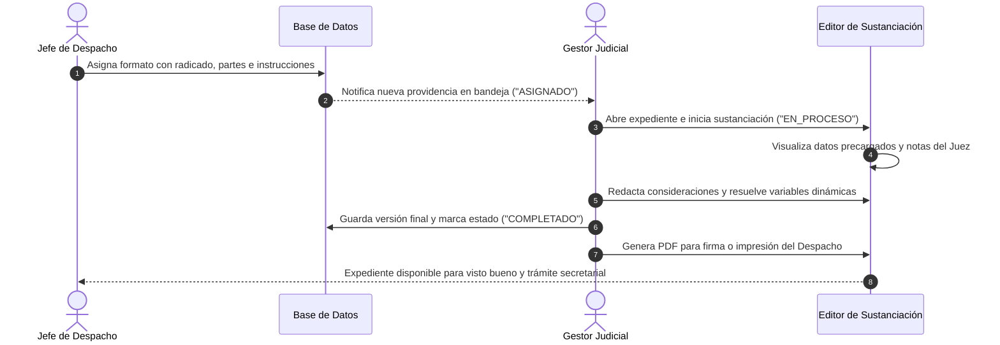

# Documento de Contexto y Especificación de Requisitos Funcionales (ERS)
## Sistema de Gestión de Formatos, Sustanciación Judicial y Automatización Inteligente de Providencias

---

### Control del Documento
- **Proyecto:** Propuesta Tecnológica para Despacho Judicial (Juzgado Cuarto de Familia de Oralidad de Medellín)
- **Ámbito:** Proyecto Formativo SENA (Análisis y Desarrollo de Software - ADSO) / Modernización Judicial
- **Rol:** Analista de Desarrollo de Software / Arquitecto de Requisitos
- **Versión:** 1.0.0
- **Fecha de Emisión:** 26 de Octubre de 2026
- **Estado:** Aprobado para Construcción y Verificación

---

## 1. Contexto General del Negocio y Problemática

### 1.1. Contexto Operativo
En el marco de la Rama Judicial de la República de Colombia, los despachos judiciales (particularmente los Juzgados de Familia de Oralidad) enfrentan una carga procesal crítica derivada de la interposición masiva de **Acciones Constitucionales de Tutela**, solicitudes de **Medidas Cautelares Provisionales**, incidentes de desacato y procesos sustantivos de familia.

El despacho de referencia, **Juzgado Cuarto de Familia de Oralidad de Medellín**, bajo la titularidad del **Dr. Juan Pablo Velásquez**, requiere herramientas que garanticen estricto apego a los términos perentorios de ley (p. ej. 10 días hábiles para sentencias de tutela, 48 horas para medidas urgentes), eliminando cuellos de botella y minimizando el error humano.

### 1.2. Problemática Identificada
1. **Dispersión y desactualización de minutas:** Los funcionarios sustancian sobre formatos heterogéneos en procesadores de texto locales (archivos `.docx` en carpetas compartidas o discos locales), lo que induce duplicidad de plantillas obsoletas o falta de uniformidad institucional.
2. **Fricción en la sustitución de datos procesales:** La transcripción manual de números de radicado (23 dígitos), nombres de accionantes, accionados, entidades vinculadas y fechas acarrea errores mecánicos recurrentes de "copiar y pegar" (errores de homonimia, inconsistencias en el resuelvo).
3. **Pérdida de trazabilidad en la delegación de casos:** El reparto interno de providencias desde el Juez hacia los auxiliares sustanciadores (gestores judiciales) suele gestionarse de manera informal o verbal, careciendo de un tablero centralizado de control de estados procesales (`ASIGNADO`, `EN_PROCESO`, `COMPLETADO`).
4. **Desconexión entre herramientas ofimáticas e Inteligencia Artificial:** La adopción de IA suele verse obstaculizada por interfaces complejas o que no respetan la estructura formal del expediente judicial colombiano ni la integridad de los documentos oficiales en formato Microsoft Word.

### 1.3. Propuesta de Valor y Solución de Software
El sistema desarrollado es una **Plataforma Web Especializada de Automatización Documental y Gestión Judicial Colaborativa**, orientada a:
- Centralizar y gobernar los **Formatos Maestros** del Despacho (Autos Admisorios, Medidas Provisionales, Autos de Traslado, Proyectos de Sentencia).
- Admitir la ingesta nativa y renderizado fiel de archivos Microsoft Word (`.docx`) originales sin alterar su composición tipográfica.
- Integrar un **Motor Semántico Híbrido de Inteligencia Artificial** (Google Gemini 2.0 Flash y analizador semántico heurístico judicial) que deduce automáticamente los campos variables (`{{RADICADO}}`, `{{ACCIONANTE}}`, `{{TERMINO}}`, etc.) y permite su parametrización masiva en segundos.
- Proporcionar un **Espacio de Trabajo Diferenciado por Roles**:
  - Un panel de control estratégico para el **Jefe de Despacho** (Juez Titular).
  - Una bandeja de sustanciación operativa para los **Gestores Judiciales**.
- Integrar un **Editor Visual Enriquecido** para sustanciar providencias, reemplazar variables sincronizadas y generar versiones definitivas en formato PDF oficial o impresión inmediata.
- Implementar una interfaz diseñada bajo la filosofía del **Neo-Brutalismo Institucional Sobrio**, garantizando máxima legibilidad, foco de lectura y austeridad visual.

---

## 2. Definición de Actores y Matriz de Roles

### 2.1. Actores del Sistema
| Actor | Código | Descripción del Rol |
|---|---|---|
| **Jefe de Despacho** | `JEFE_DESPACHO` | Titular del Juzgado (Juez) o Secretario Judicial con máximas atribuciones administrativas, parametrizadoras, delegatorias y decisorias. |
| **Gestor Judicial** | `GESTOR` | Auxiliar judicial, escribiente, oficial mayor o profesional universitario encargado de la sustanciación, diligenciamiento de hechos y proyección de autos/sentencias. |
| **Motor de IA / Servicio Externo** | `SYSTEM_AI` | Componente de inteligencia artificial (Google Gemini API / Motor Heurístico Local) que procesa lenguaje natural, categoriza variables y detecta ocurrencias textuales. |

### 2.2. Matriz de Permisos Granulares
El sistema modela permisos específicos que determinan las capacidades operativas de cada cuenta:

| Código de Permiso | Nombre Funcional | Categoría | Descripción Técnica |
|---|---|---|---|
| `RADICAR_EXPEDIENTES` | Radicación de Expedientes | Operativo | Registrar y clasificar expedientes de tutela con código único de 23 dígitos. |
| `ANALIZAR_TUTELAS` | Análisis Fáctico y Criterios | Operativo | Evaluar la solicitud, derechos fundamentales conculcados y procedencia de medidas provisionales. |
| `GENERAR_PROVIDENCIAS` | Generación de Borradores IA | Operativo | Invocar el motor de IA para deducir variables y sustanciar borradores de providencias. |
| `APROBAR_PROVIDENCIAS` | Aprobación y Visto Bueno | Decisorio | Validar, firmar y aprobar resoluciones proyectadas para expedición formal. |
| `ADMINISTRAR_EQUIPO` | Administración del Personal | Administración | Registrar personal judicial, gestionar estados de actividad y modular sus permisos. |
| `CONFIGURAR_DESPACHO` | Configuración del Juzgado | Administración | Modificar membretes oficiales, códigos institucionales y formatos maestros. |

---

## 3. Especificación de Requisitos Funcionales (RF)

### Módulo 1: Control de Acceso y Gestión de Sesión (`features/auth`)

#### RF-01: Autenticación Unificada por Perfil Judicial
- **Actor:** Jefe de Despacho, Gestor Judicial.
- **Descripción:** El sistema debe permitir a los usuarios iniciar sesión mediante su correo institucional judicial (`@ramajudicial.gov.co`) y credencial de seguridad.
- **Precondiciones:** El usuario debe existir en la base de datos y tener el atributo `activo: true`.
- **Reglas de Negocio:**
  - El sistema debe soportar un selector rápido de perfiles demo preconfigurados para pruebas operativas en despachos pilotos.
  - La sesión debe persistirse de forma segura mediante cookies HTTP-Only (`juzgado_session_id`) con política SameSite Lax.
  - Si un usuario está inactivo (`activo: false`), el sistema denegará el acceso informando que consulte con el Jefe de Despacho.
- **Criterios de Aceptación:**
  - *Dado* un usuario registrado y activo, *cuando* ingrese sus credenciales válidas, *entonces* el sistema redirige al panel de control correspondiente a su rol.
  - *Dado* un usuario inactivo, *cuando* intente ingresar, *entonces* el sistema bloquea el acceso con mensaje de advertencia.

#### RF-02: Cierre Seguro de Sesión
- **Actor:** Todos los usuarios autenticados.
- **Descripción:** El usuario podrá revocar su sesión activa en cualquier momento desde la barra superior (`TopBar`).
- **Postcondición:** La cookie de sesión se destruye en el navegador y el sistema retorna inmediatamente a la pantalla de login.

---

### Módulo 2: Catálogo de Formatos Maestros y Gestión Word (`features/formatos`)

#### RF-03: Creación y Parametrización Manual de Formato Maestro
- **Actor:** Jefe de Despacho.
- **Descripción:** El Jefe de Despacho podrá dar de alta formatos judiciales desde cero en texto enriquecido.
- **Datos de Entrada:**
  - Código Institucional Único (alfanumérico, ej. `AUT-ADM-MC-01`).
  - Título Descriptivo (ej. "Auto Admisorio con Medida Cautelar Provisional").
  - Tipo de Formato: `AUTO_ADMISORIO`, `MEDIDA_PROVISIONAL`, `AUTO_TRASLADO`, `PROYECTO_SENTENCIA`, `OTRO`.
  - Descripción y Justificación de Uso.
  - Cuerpo de Plantilla con sintaxis de tokens variables `{{NOMBRE_VARIABLE}}`.
- **Reglas de Negocio:**
  - El código institucional es único en el sistema (no admite duplicados y se normaliza en mayúsculas).
  - Solo los usuarios con rol `JEFE_DESPACHO` tienen autorización para crear o modificar formatos maestros.
- **Salida:** Formato maestro almacenado y disponible inmediatamente en el catálogo institucional.

#### RF-04: Carga e Ingesta de Documentos Oficiales en Formato Word (`.docx`)
- **Actor:** Jefe de Despacho.
- **Descripción:** El sistema debe permitir cargar minutas y providencias existentes en formato binario Microsoft Word (`.docx`).
- **Procesamiento Técnico:**
  - Almacenamiento seguro del binario en base64 en la base de datos (`archivoBase64` y `archivoNombre`).
  - Conversión del contenido del `.docx` a formato HTML estructural mediante `mammoth` para habilitar su edición interactiva y detección de variables.
  - Marcado del registro con la bandera `esDocumentoWord: true`.
- **Criterios de Aceptación:**
  - Al subir un archivo `.docx`, el sistema debe permitir visualizar tanto la vista original fiel como el borrador editable para parametrización de variables.

#### RF-05: Visor de Documentos Word Originales de Alta Fidelidad
- **Actor:** Jefe de Despacho, Gestor Judicial.
- **Descripción:** El sistema debe proveer un visor flotante modal que utilice `docx-preview` para renderizar el documento original tal como se diseñó en Microsoft Word (respetando tablas, saltos de página oficiales, márgenes, membretes gráficos y fuentes).
- **Controles del Visor:** Zoom in (+), Zoom out (-), restablecimiento de escala y advertencia de fidelidad de diseño.

#### RF-06: Edición y Eliminación Controlada de Formatos Maestros
- **Actor:** Jefe de Despacho.
- **Descripción:** El Jefe de Despacho podrá modificar los metadatos o la plantilla de cualquier formato maestro, así como eliminarlo mediante un diálogo de confirmación explícita de destrucción.
- **Regla de Negocio:**
  - Si un formato tiene asignaciones vigentes, la eliminación en cascada o la advertencia de integridad referencial debe aplicarse según la política del juzgado.

---

### Módulo 3: Motor de Inteligencia Artificial y Parametrización Semántica (`Analizador IA`)

#### RF-07: Detección Semántica Híbrida de Variables Judiciales
- **Actor:** Jefe de Despacho, Gestor Judicial.
- **Descripción:** El usuario podrá invocar el analizador de IA sobre cualquier formato maestro o documento cargado para deducir qué fragmentos de texto corresponden a información variable dinámica.
- **Modos de Operación:**
  1. **Google Gemini 2.0 Flash (Cloud IA):** Invoca el modelo generativo enviando el contenido y un prompt estructurado de análisis procesal para extraer campos, sinónimos y descripciones con razonamiento contextual.
  2. **Motor Heurístico Judicial Local (Fallback):** En caso de no contarse con API Key o fallos de conexión, opera un motor regex local basado en patrones judiciales colombianos (radicados de 23 dígitos, fórmulas de notificación, partes procesales, fechas, despachos).
- **Taxonomía de Categorías de Variables:**
  - `RADICADO`, `ACCIONANTE`, `ACCIONADO`, `CONTRATO`, `CONTRATISTA`, `SUPERVISOR`, `NOMBRE_PERSONA`, `CARGO`, `DIRECCION`, `ASUNTO`, `FECHA`, `PERIODO`, `DESPACHO`, `CIUDAD`, `JUEZ`, `VALOR`, `PORCENTAJE`, `TERMINO`, `NUMERO_AUTO`, `DOCUMENTO_ID`, `OTRO`.
- **Regla de Negocio (Lista Negra de Protección):**
  - El analizador NUNCA debe sugerir como variables los rótulos estáticos de membrete institucional (p. ej. "REPÚBLICA DE COLOMBIA", "RAMA JUDICIAL", "NOTIFÍQUESE Y CÚMPLASE", "CONSIDERACIONES", "RESUELVE", "SENA"), preservando intacta la estructura legal del acto procesal.

#### RF-08: Gestión y Homologación de Variables Sugeridas en Modal IA
- **Actor:** Jefe de Despacho, Gestor Judicial.
- **Descripción:** El sistema debe presentar una lista interactiva de variables detectadas donde el usuario puede:
  - Seleccionar o deseleccionar variables individuales o en lote.
  - Editar el nombre sugerido de la variable (ej. cambiar `JUAN_PEREZ` por `ACCIONANTE_PRINCIPAL`).
  - Visualizar el conteo de ocurrencias exactas en el texto.
  - Configurar y persistir localmente su clave personal de Google Gemini (`API Key`).
- **Postcondición:** Al hacer clic en "Aplicar Variables", el sistema sustituye todas las ocurrencias en el documento por las etiquetas canónicas `{{NOMBRE_VARIABLE}}`.

#### RF-09: Marcación Rápida Manual de Variables (Menú Flotante y Popover)
- **Actor:** Gestor Judicial, Jefe de Despacho.
- **Descripción:** Al resaltar cualquier fragmento de texto en el editor visual, debe desplegarse un menú flotante contextual que permita:
  - Asignar una variable rápida (`RADICADO`, `ACCIONANTE`, `ACCIONADO`, `FECHA`, etc.).
  - Definir una variable personalizada en mayúsculas sostenidas (`UPPERCASE_SNAKE_CASE`).
  - Sincronizar dinámicamente el valor en todas las repeticiones del documento.

---

### Módulo 4: Delegación y Bandeja de Sustanciación Colaborativa

#### RF-10: Delegación de Formatos a Gestores Sustanciadores
- **Actor:** Jefe de Despacho.
- **Descripción:** El Jefe de Despacho podrá asignar formalmente un formato a un gestor de su equipo para atender un expediente específico.
- **Datos de Asignación:**
  - Formato Maestro seleccionado.
  - Gestor Judicial asignado (de la lista de gestores activos).
  - Número de Radicado Judicial (23 dígitos).
  - Nombre del Accionante.
  - Nombre del Accionado.
  - Instrucciones procesales específicas del Juez (criterios de fondo, medidas cautelares urgentes a ordenar, pruebas a practicar).
- **Procesamiento:** El sistema inicializa automáticamente la instancia del documento inyectando los valores de radicado, accionante y accionado en los placeholders correspondientes.
- **Estado Inicial:** `ASIGNADO`.

#### RF-11: Bandeja de Entrada Personalizada del Gestor Judicial
- **Actor:** Gestor Judicial.
- **Descripción:** El gestor dispondrá de una vista consolidada de los expedientes delegados a su cargo, con:
  - Indicadores numéricos en tiempo real: Total de casos asignados, En Trámite / Borrador, Providencias Listas / Completadas.
  - Filtro por estado procesal (`TODOS`, `EN_PROCESO`, `COMPLETADO`).
  - Búsqueda en vivo por radicado, título de formato o nombre de las partes.
  - Visualización prioritaria de las instrucciones dictadas por el Juez.

#### RF-12: Diligenciamiento, Sustanciación y Control de Estados
- **Actor:** Gestor Judicial.
- **Descripción:** El gestor abrirá el modal de sustanciación sobre el expediente asignado para completar los hechos, consideraciones y parte resolutiva.
- **Capacidades Operativas:**
  - Guardar borrador intermedio actualizando el estado a `EN_PROCESO`.
  - Finalizar la sustanciación actualizando el estado a `COMPLETADO`.
  - Reabrir expedientes para correcciones requeridas por el Despacho.
- **Regla de Integridad:** Un gestor solo puede modificar los expedientes que hayan sido formalmente delegados a su identificador de usuario.

---

### Módulo 5: Administración del Despacho y Talento Humano (`features/equipo`)

#### RF-13: Creación y Vinculación de Gestores Judiciales
- **Actor:** Jefe de Despacho.
- **Descripción:** El Juez Titular podrá registrar nuevos integrantes en el equipo del Despacho.
- **Datos Requeridos:**
  - Nombre completo.
  - Documento de identidad.
  - Cargo oficial (Escribiente, Sustanciador, Profesional Universitario, etc.).
  - Correo electrónico institucional.
  - Asignación inicial de permisos.
- **Postcondición:** El gestor queda habilitado inmediatamente para recibir asignaciones de expedientes y sustanciar providencias.

#### RF-14: Gestión Modular de Permisos del Personal
- **Actor:** Jefe de Despacho.
- **Descripción:** El Jefe de Despacho podrá auditar y modificar la matriz de permisos de cualquier gestor existente mediante un selector visual clasificado por categorías (Operativo, Decisorio, Administrativo).

#### RF-15: Monitoreo de Métricas del Equipo Judicial
- **Actor:** Jefe de Despacho.
- **Descripción:** Tablero de estadísticas con el total de colaboradores activos, porcentaje de cobertura de permisos decisorios y carga operativa global del juzgado.

---

### Módulo 6: Salidas Oficiales, Exportación e Impresión Documental

#### RF-16: Vista Previa Judicial de Alta Fidelidad
- **Actor:** Jefe de Despacho, Gestor Judicial.
- **Descripción:** Componente de previsualización que simula la hoja judicial de fallo conforme a las directrices de la Rama Judicial (márgenes oficiales, numeración, escudo de la República, membrete centrado, interlineado reglamentario y pie de firma del Juez Titular).

#### RF-17: Exportación a Documento Portable (PDF) e Impresión Directa
- **Actor:** Jefe de Despacho, Gestor Judicial.
- **Descripción:**
  - **Descarga PDF:** Generación del archivo `.pdf` mediante `html2pdf.js`, sanitizando etiquetas interactivas y conservando tipografías, justificación de texto y márgenes de impresión judicial.
  - **Impresión Directa:** Envío del documento limpio a la cola de impresión del sistema operativo, apto para la firma física o digital del funcionario judicial.

---

## 4. Requisitos No Funcionales (RNF)

### 4.1. Arquitectura y Rendimiento
- **RNF-01 (Feature-Driven Architecture):** El código debe organizarse estrictamente en rebanadas verticales (*Vertical Slices*) dentro de `src/features/`, separando lógica en *Custom Hooks* y persistencia en *Server Actions*, manteniendo la capa de UI puramente presentacional.
- **RNF-02 (Tiempos de Respuesta):**
  - Carga inicial de bandejas de trabajo: `< 1.2 segundos`.
  - Reemplazo y sincronización de variables en memoria: `< 100 milisegundos`.
  - Inferencia y análisis con IA: `< 4.5 segundos` (dependiente de latencia de red con la API de Google Gemini).

### 4.2. Usabilidad y Sistema de Diseño (Neo-Brutalismo Sobrio)
- **RNF-03 (Estilo Visual Institucional):** La interfaz debe implementar el sistema de diseño brutalista definido en `docs/reglas-de-diseno.md`:
  - Bordes sólidos marcados: `border-2 border-[#0F172A]` (Azul Noche/Pizarra).
  - Sombras duras de bloque sin desenfoque: `shadow-[3px_3px_0px_#0F172A]` o `shadow-[4px_4px_0px_#0F172A]`.
  - Paleta cromática oficial: Azul Petróleo (`#0F2537`) para jerarquía institucional, Vinotinto Judicial (`#6B1D2F`) para acciones decisorias y medidas urgentes, Dorado Judicial (`#9A7B3E`) para acentos primarios, y Blanco Hueso (`#F8F9FA`) para superficies de lectura.
  - Cero degradados difusos o efectos *glassmorphism*.
  - Micro-interacciones de hundimiento táctil (`active:translate-x-[2px] active:translate-y-[2px] active:shadow-none`).

### 4.3. Seguridad y Confidencialidad
- **RNF-04 (Protección de Credenciales y Sesión):** Cookies de sesión configuradas con atributos `HttpOnly`, `SameSite=Lax` y encriptación de transporte `HTTPS` obligatoria en entornos productivos.
- **RNF-05 (Aislamiento de Claves de IA):** La API Key personal de Google Gemini provista por el usuario debe custodiarse en el almacenamiento del cliente (`localStorage`), transmitiéndose únicamente en la invocación puntual de análisis sin quedar expuesta en logs de base de datos.

### 4.4. Compatibilidad y Portabilidad
- **RNF-06 (Formatos Abiertos e Interoperabilidad):** Soporte integral para archivos OpenXML (`.docx`), serialización HTML5 estándar y exportación a estándar ISO 32000 (PDF).
- **RNF-07 (Multi-navegador):** Funcionamiento validado en navegadores modernos (Google Chrome, Microsoft Edge, Mozilla Firefox) en sistemas operativos de escritorio utilizados en las sedes judiciales (Windows 10/11, Linux).

---

## 5. Modelo de Datos y Entidades del Sistema

### 5.1. Diccionario de Enums del Dominio
- **`Rol`**:
  - `JEFE_DESPACHO`: Dirección estratégica y decisoria del juzgado.
  - `GESTOR`: Sustanciación, proyección y trámite operativo.
- **`TipoFormato`**:
  - `AUTO_ADMISORIO`: Admisión formal de la acción judicial.
  - `MEDIDA_PROVISIONAL`: Auto interlocutorio cautelar urgente de tutela.
  - `AUTO_TRASLADO`: Requerimiento de contestación e informes a entidades.
  - `PROYECTO_SENTENCIA`: Fallo de primera instancia constitucional.
  - `OTRO`: Providencias interlocutorias o de sustanciación general.
- **`EstadoAsignacion`**:
  - `ASIGNADO`: Delegado por el Juez, pendiente de inicio por el gestor.
  - `EN_PROCESO`: En etapa de redacción, adaptación fáctica y consideraciones.
  - `COMPLETADO`: Borrador listo para revisión final y suscripción por el Juez.

---

## 6. Flujos de Procesos de Negocio Principales

### 6.1. Flujo A: Ingesta, Análisis con IA y Parametrización de un Formato

### 6.2. Flujo B: Delegación y Sustanciación de un Expediente de Tutela

---

## 7. Criterios de Calidad y Validación para Aceptación

1. **Integridad del Documento:** Ninguna conversión de formato Word o reemplazo con IA debe mutilar párrafos normativos, decretos citados o membretes oficiales.
2. **Coherencia de Variables:** Si una variable como `{{ACCIONANTE}}` se modifica en el encabezado, el cambio debe propagarse idénticamente a todas sus menciones en el cuerpo de la providencia.
3. **Respeto a las Reglas de Arquitectura:**
   - Cero componentes monolíticos mayores a 150 líneas sin modularizar.
   - Prohibición estricta de ejecución de navegadores autónomos por el agente (pruebas reservadas al usuario).
   - Estricto cumplimiento del Neo-Brutalismo sobrio sin efectos difuminados.
